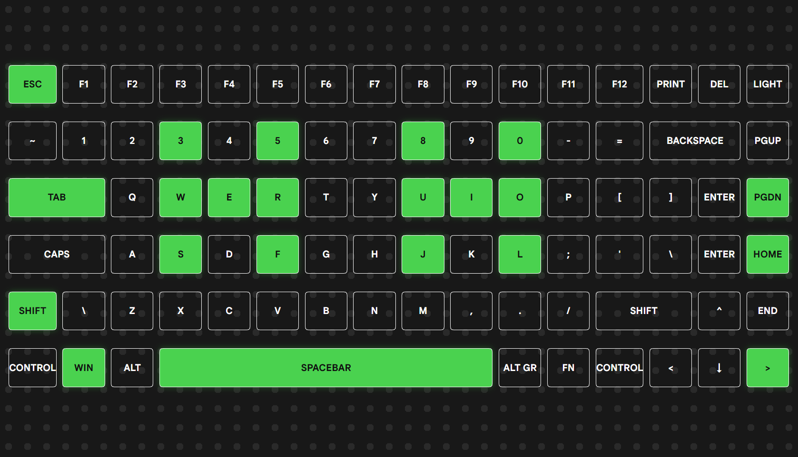
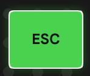

# Keyboard Tester

Keyboard Tester is the project I build to test if every keyboard is working fine!

I decided to build my owm because I was looking how JavaScript handles user input and also because I always wanted to build something similar

You can test it [here](https://brundevcoder.github.io/KeyboardTester/)

## How does it work?
Keyboard Tester is very simples!

When you open the website, you just need to press to keys in your keyboard and see if they are working correctly

If they turn green, that means that there are working fine, if not, the key probably isn't working or (read the next part)

like this:
Without pressing:

Pressing:

### Some keys don't work!?!
There are also some keys that may not work here, like "Print", "Light" and "FN" because I guess JavaScript just really doesn't support that.